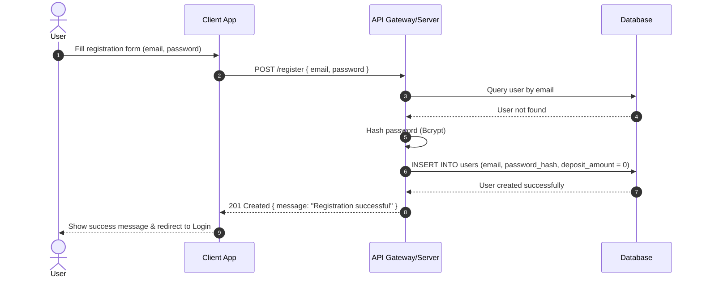
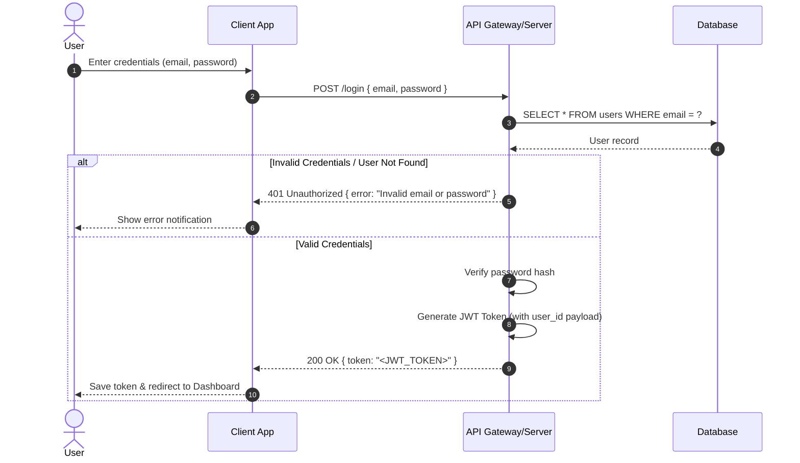
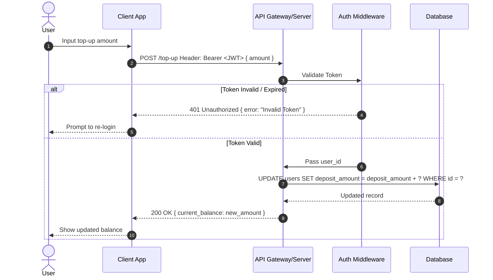
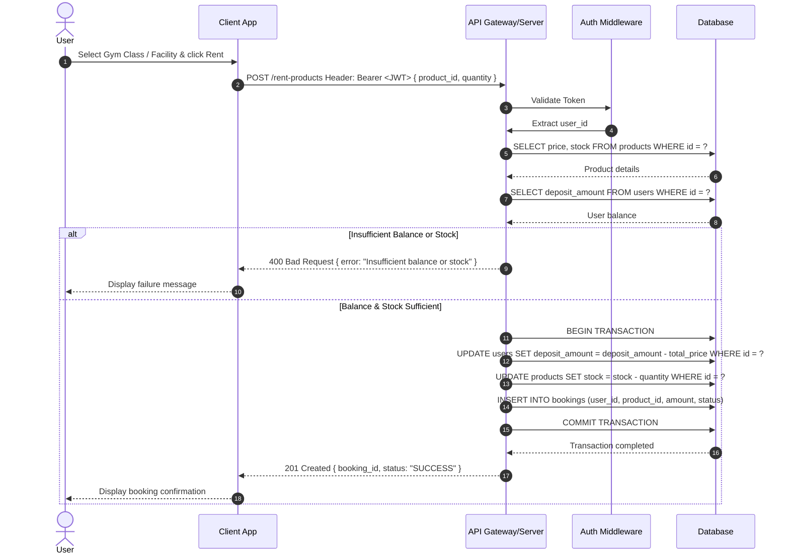
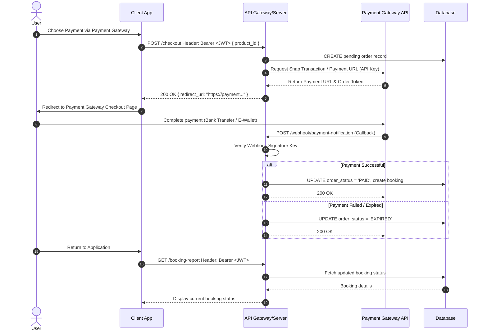
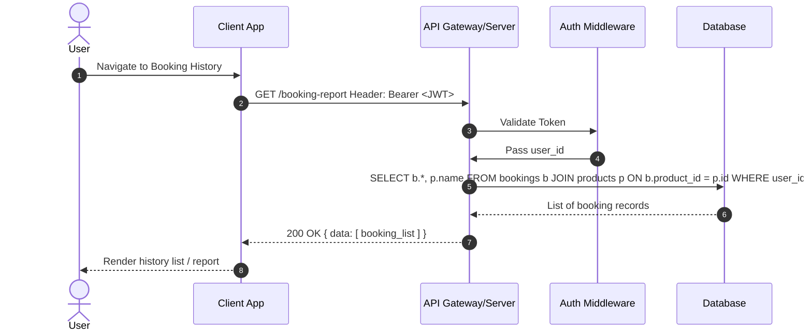

# Gym Membership System - Sequence Diagrams

---

## 1. User Registration Flow (`POST /register`)

---

## 2. User Login Flow (`POST /login`)

---

## 3. Balance Top-Up Flow (`POST /top-up`)

---

## 4. Product Rental / Booking Flow (`POST /rent-products`)

---

## 5. Third-Party Payment Gateway Integration (e.g., Midtrans / Xendit)

---

## 6. Booking Report Flow (`GET /booking-report`)

